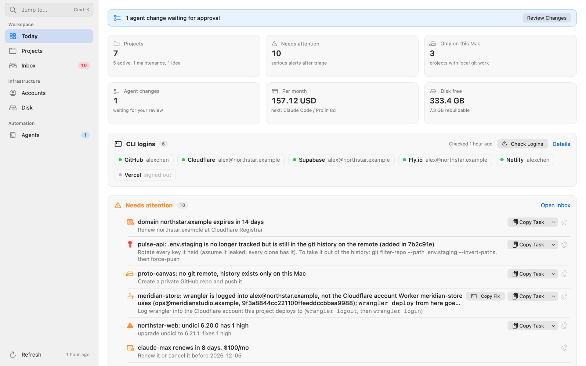

# HQ (Helios Query)

Track the software projects, accounts, and AI agents on your Mac.

- **[Overview & Download Page](https://futogabor.github.io/hq-releases/)** — screenshots, what HQ checks, privacy rules, and direct download
- **[Download Latest (`HQ-0.17.0.zip`)](https://github.com/futogabor/hq-releases/releases/latest)** — Apple Silicon (M1+), macOS 15+, signed and notarized
- **[All Releases](https://github.com/futogabor/hq-releases/releases)** | **[Report an Issue](https://github.com/futogabor/hq-releases/issues)** | **[Buy Me a Coffee](https://buymeacoffee.com/gaborfuto)**

  <a href="https://futogabor.github.io/hq-releases/">
    <picture>
      <source media="(prefers-color-scheme: dark)" srcset="assets/screens/today-dark.png">
      <source media="(prefers-color-scheme: light)" srcset="assets/screens/today-light.png">
      
    </picture>
  </a>

## What HQ does

HQ (Helios Query) is a native Mac app, command-line tool, and local MCP server that keeps track of every software project on your Mac:

- **Push & deploy preflight:** Compares project configs (`wrangler.toml`, `firebase.json`, `supabase`, `vercel.json`, `gcloud`, AWS `sam`/`cdk`/`serverless`, `fly.toml`, `netlify.toml`, `doctl`, git remotes & SSH aliases) against your active CLI sessions and commit email before a push or deploy runs.
- **Secret & vulnerability checks:** Flags `.env` and credential files in git or git history by filename only (never opening them), plus opt-in built-in OSV vulnerability checks across 17 lockfile formats (npm, pnpm, yarn, Bun, Python, Rust, Go, Swift, CocoaPods, Ruby, PHP, Dart) with CVE/advisory summaries, major-upgrade warnings, and `endoflife.date` runtime tracking.
- **Multi-account CLI logins & renewals:** Shows active logins across 18+ platform CLIs (`gh`, `wrangler`, `supabase`, `firebase`, `vercel`, `aws`, `gcloud`, `flyctl`, `netlify`, `doctl`, and more), remembers which account owns each project across CLI switches without storing credentials, collapses global CLI mismatches into one provider-level alert with switch/isolation recipes, and tracks subscription renewals, RDAP domain expiry, and TLS certificate dates.
- **Local MCP server, daily triage & push guard for AI agents:** Optional setup for **Claude Code**, **Codex**, **Cursor**, **Antigravity**, and **git 2.54+** with a compact MCP server (`Core` 9-tool mode including single-call `triage`, or `All` 29 tools), `hq today` CLI briefing, push/deploy guard hooks, and optional cross-agent session handoffs — without spending AI tokens on routine checks.
- **Disk map & safe cleanup:** Zoomable folder size map and a list of rebuildable build folders (`node_modules`, `DerivedData`, `.next`, `target`); moves git-ignored folders to the Trash only after you confirm and refuses any folder containing git worktrees or checkouts.

## Install

1. Open the **[Overview & Download Page](https://futogabor.github.io/hq-releases/)** or download `HQ-<version>.zip` from **[Latest Release](https://github.com/futogabor/hq-releases/releases/latest)**.
2. Unzip `HQ.app` and move it to your **Applications** folder.
3. Open **HQ** and follow the 5-step Setup Guide.

Requires a Mac with Apple silicon (M1 or later) and macOS 15 or later. HQ is signed with a Developer ID, notarized by Apple, and updates via Sparkle (EdDSA-verified).

## What HQ reads, and what it never does

- **Read-only on your projects:** Never moves, renames, or deletes anything inside scanned folders (except moving git-ignored build folders without git worktrees to the Trash when you confirm).
- **No secrets:** `.env`, key, token, and credential files are recorded by name and never opened. HQ never stores passwords, tokens, or API keys.
- **Stays on your Mac:** No HQ account and no telemetry. Your registry is plain YAML files in your own local git repo (`~/HQ` by default), and every outbound request is listed in **Settings > Network**.
- **Agents ask, you decide:** Proposed changes to accounts, links, URLs, domains, project paths, archiving, and renewals wait for your approval in HQ.app, and every registry change is a revertible git commit.

## About this repository

This repository hosts HQ's public introduction page (GitHub Pages), signed release archives on GitHub Releases, the Sparkle update feed (`appcast.xml`), and public issue tracking.
